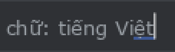
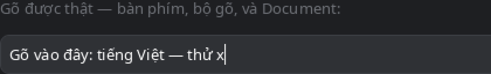
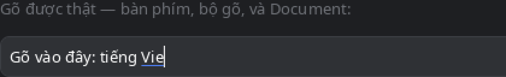
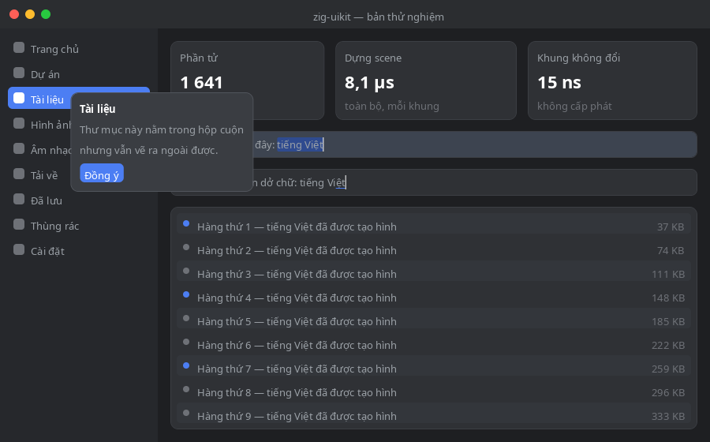
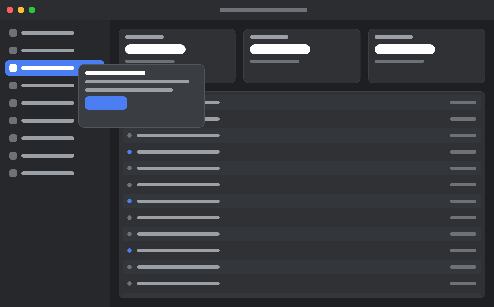
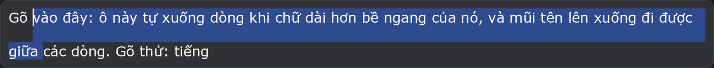

# zig-uikit

A declarative GPU UI toolkit for Zig.

> **Status: pre-alpha.** The layout core, the scene layer, a Vulkan renderer
> with a Wayland window, a Metal renderer with a macOS window, a shaped-text
> stack, a keyboard and input methods on both platforms that type into one
> document, and an AT-SPI accessibility tree, exist and are tested. Both
> backends draw text; accessibility is Linux-only so far.
> There are no widgets. Expect the API to change without notice.

```sh
zig build test                           # 197 tests, no platform dependencies
zig build demo                           # renders docs/demo.png in software
zig build bench -Doptimize=ReleaseFast   # what it costs
zig build test-text                      # 19 tests, needs a font installed
zig build test-input                     # 14 tests, needs xkbcommon and a layout
zig build check-macos                    # type-checks the macOS sources, from Linux
zig build test-gpu                       # Vulkan: 8 tests; Metal: 11 tests
zig build gpu-demo                       # renders on the GPU, diffs against the reference
zig build window                         # opens a window and renders into it
```

`window` takes `--capture`, `--sweep`, `--type` and `--a11y-events`; `--type`
scripts a sequence of keystrokes through the editable field and reports what
each one cost. The last two steps follow the target: Vulkan and Wayland on
Linux, Metal and AppKit on macOS. `test-input` is Linux-only, and so is the
AT-SPI bridge, which the window starts if an accessibility bus is there and
runs without if it is not.
`zig build test` needs nothing. Everything else links fontconfig,
FreeType and HarfBuzz, because the demos share one source file and that file
can set text — on macOS that means Homebrew:
`brew install harfbuzz freetype fontconfig pkgconf`.


Everything above is drawn by this repository: layout, clipping, culling, the
popover escaping the panel that owns it, the text, and the pixels themselves.
There is no window and no GPU involved — that image is the software reference
rasteriser. The text is shaped by HarfBuzz and rasterised by FreeType, and it is
in Vietnamese because `tiếng Việt` stacks a tone mark over a vowel that already
carries a diacritic, which is the shortest string that tells you whether a text
stack actually shapes or merely maps codepoints to glyphs.

```zig
var t = try ui.Tree.init(gpa);
defer t.deinit();

try t.setStyle(t.root(), .{ .axis = .col, .padding = 8, .gap = 4 });
const row = try t.appendChild(t.root(), .{ .axis = .row, .height = .{ .fixed = 32 } });
const label = try t.appendChild(row, .{ .width = .{ .grow = 1 } });

t.setPaint(row, .{ .background = ui.Color.hex(0x2F3135), .corner_radius = 6 });

t.layout(.{ .w = 1280, .h = 720 });

// Later. Only what changed is recomputed; an unchanged frame does nothing.
try t.setStyle(label, .{ .width = .{ .grow = 2 } });
const cost = t.flush();   // .intrinsic, .position, .fast_path, .slow_path

var scene = ui.Scene.init(gpa);
_ = try scene.build(&t);  // a flat list of 60-byte quads, ready to upload
```

Text is installed on an element, not drawn by a call:

```zig
var lib = try text.Library.init();
var font = try lib.open(gpa, "sans", 13);     // fontconfig matches the family
var atlas = try text.Atlas.init(gpa, 512, 512);

try text.setText(&t, label, &font, &atlas, "Xin chào");
t.setPaint(label, .{ .text_color = ui.Color.white });
```

`setText` shapes and dirties layout, because text is a size input. `setPaint`
does not, because colour is not. That split is the whole design in one line.

The tree is **retained and mutated**, not rebuilt per frame. That is the whole
point: a frame arena reset wholesale cannot reuse last frame's subtrees, which
is where the saving comes from. A declarative layer belongs on top of this, and
`setStyle` compares before marking dirty so that re-setting an unchanged style
every frame costs nothing.

## The scene layer

`Paint` is a separate struct from `Style`, reached by a separate setter, and
that separation is the point rather than tidiness. `Style.eql` is what decides
whether an element is dirty for layout, so a background colour living in `Style`
would mean that recolouring a button runs the flexbox engine over its container.
Measured on this library, 1 641 elements:

| | cost | for comparison |
| --- | --- | --- |
| `flush()`, nothing changed | **1.3 ns** | GPUI unchanged frame: 2.32 ms of CPU |
| `setPaint` a leaf + `flush()` | **1.9 ns** | GPUI leaf style: 3.9 ms |
| `setStyle` a leaf's *size* + `flush()` | 142 ns | propagates; no GPUI equivalent |
| full `layout()` | 24 us | GPUI full refresh: 3.50 ms |
| `Scene.build`, nothing changed | 3.8 ns | one integer comparison |
| `Scene.build`, full rebuild | 8.4 us | 0.36% of GPUI's unchanged frame |
| `Scene.build`, full rebuild **with text** | 24 us | 8 985 quads, 7 344 of them glyphs |

This is the first time the shipped library has been measured rather than the
prototype in the benchmark repository, and the point of running it was that it
could have failed. It did not.

The scene is **rebuilt whole, never patched**. A full rebuild is 8.4 us against
the 2.32 ms it is competing with, so a second dirty-tracking system would be
maintaining bugs in exchange for microseconds. What keeps the headline claim
true end to end is instead a revision counter: `Scene.build` returns after one
integer comparison when nothing has changed.

There is one primitive, a 60-byte clipped rectangle, and it carries its own
absolute clip rectangle rather than relying on push/pop state — so the list
survives being bucketed by painting layer, the GPU gets one draw call, and a
subtree outside its clip is skipped in a single test.

**A glyph is that same primitive**, with its coverage read from an atlas instead
of from a distance field. The alternative — a second list and a second pipeline
for text — would mean interleaving draw calls to keep a label painting over its
own background, which is to say reconstructing by hand the ordering that one
sorted list gives for free. The cost of not doing that is twelve bytes on every
box quad in the scene: 48 became 60, and a full rebuild of the 1 641-element
grid went from 8.1 us to 8.4 us. The struct is deliberately *not* padded out to
a 64-byte cache line, because 6% more bandwidth to buy an aligned instance fetch
is not something any measurement here asks for.

`src/raster.zig` is a software rasteriser. It is **not** the renderer: it exists
because paint is the one part of a toolkit that cannot be checked by asserting
on numbers, and `coverage` in it is the signed distance field the GPU shader
was written from, so the two cannot quietly disagree.

### Two bugs the picture found that the tests did not

Rendering the demo immediately falsified something the test suite had been happy
with for 46 tests. A single non-wrapping flex line was taking its cross size as
the *largest child*, where CSS 9.4 step 8 says it is the *container's inner
cross size*. An invisible 116-pixel popover anchor inside a 28-pixel toolbar row
was therefore pushing that row's icon and label 51 pixels down. Fixing it also
deleted a per-element cache: the correct rule needs no maximum over siblings, so
the fast path got smaller as well as right.

The second: `clip_children` was clipping at the element's outer edge, so the
first overflowing child painted straight over the border meant to contain it.
CSS clips to the padding box. Both now have regression tests, but neither was
going to be found by writing more assertions.

### Out of flow

`position: .absolute` takes an element out of its parent's flow and places it
at `left`/`top` from the parent's content origin. It contributes nothing to its
parent's content size and nothing to its siblings' arithmetic, and they
contribute nothing to it.

It exists because the alternative was being written over and over. A caret, a
selection highlight, a preedit underline and a popover were each **four layout
elements** — a zero-width anchor, a spacer whose *width* was the x coordinate,
a column, and a spacer whose *height* was the y — with a comment at every site
naming the feature that was missing. Five such sites, and the demo was 201
layout elements for 71 things a person would name. It is 172 now.

And it changes what a caret costs, which matters because a caret moves on
every keystroke. Measured on the same 1 649-element tree, both shapes built
side by side so the comparison is a ratio and not two sessions:

| moving a caret by one pixel | | |
| --- | --- | --- |
| a spacer's width | 71.7 ns | 8.0 units of layout work |
| an out-of-flow element | **22.8 ns** | **2.0 units** |

A spacer's width is a size change, so it climbs: the anchor's content size
changes, then the row's, and the row re-runs. An out-of-flow element cannot
change anything above it, so `flushElement` recomputes it, places it, and
stops — which is the one special case the feature adds to the layout engine.

Two deliberate differences from CSS. The offsets are relative to the **parent**
and not to a "nearest positioned ancestor": that rule is for documents, where
the thing you position against is often far up the tree, and here the parent is
the thing the overlay belongs to. And `grow` out of flow means "fill what is
left after the offset" rather than "take a share of the free space", because
there are no siblings to share with — a backdrop behind a popover wants exactly
that.

One thing a caller has to know: an out-of-flow child is **not** centred by its
parent's `align_items`, so whatever places it says where it goes. The demo's
overlays compute their vertical offset from the field's content height for
that reason, and a test pins it.

### A known divergence from CSS

`align_items` defaults to `start` here, where CSS defaults it to `stretch`. Every
container that should fill its parent across its axis has to say so. Whether
that is the right default is still open; it is written down rather than
discovered later.

## Text

`zig build test-text` — 15 tests, and they need a font installed, which is why
they are not in `zig build test`.

**HarfBuzz is in the first slice of text, not a later one.** The tempting
shortcut is one glyph per codepoint through `FT_Get_Char_Index`: about thirty
lines, and it renders English correctly. It renders `tiếng Việt` wrongly.
Vietnamese stacks a tone mark over a vowel that may already carry a diacritic,
and whether that is one precomposed glyph or two glyphs positioned by the
font's `GPOS` table is a property of the font, not of the text. Only the shaper
knows. A toolkit written in Vietnam that cannot set Vietnamese is not a toolkit
with a missing feature; it is one built on a model that has to be thrown away.

A test asserts the consequence directly: `tiếng việt` written with precomposed
characters and written with combining marks must shape to the same width and
the same glyph count. A per-codepoint renderer fails that.

Running it on a Mac, where fontconfig matches Verdana rather than DejaVu, found
two faults in the test itself. The combining spelling of `việt` was `e` + dot
below, which is `ẹ` — a different letter that happens to be as wide as `ệ` — so
the test compared two different words and passed. And it checked that the
marks on `ế` rise above the dot of the `i` in `ting`, which is a property of
the font: Verdana at 15 px sets them exactly level. It now checks that `ế`
starts higher than a bare `e`, which holds for any font with marks at all.

### The core does not link a font engine

`zig build test` still runs on a machine with no fonts, no GPU and no
compositor, and that property was worth keeping. So the split is:

- `src/text/` is a separate module. It links fontconfig, FreeType and
  HarfBuzz, and it is the only thing that knows what a font is.
- `src/glyph.zig` is in the core and is plain numbers: where each glyph sits,
  which atlas texels it reads, the run's width and the font's ascent and
  descent. The core lays out around that and emits primitives for it without
  being able to produce any of it.

The direction matters. Had `Tree.setText` taken a string and a font, the layout
core would link three C libraries. Taking an already-shaped run instead also
puts shaping where it belongs: it happens when the text changes, not once per
frame — and the measurement says why.

### Shaping costs 2.1 us, which is the argument for not doing it per frame

| | cost |
| --- | --- |
| shape a 40-character Vietnamese line, warm glyph cache | **2.1 us** |
| shape it *and* install it on an element | 2.1 us (+40 ns for the copy) |
| rebuild a scene of 8 985 quads, 7 344 of them glyphs | 24 us |
| recolour text and flush | **1.4 ns** |

Shaping one line costs a quarter of what rebuilding the entire 1 641-element
scene costs. A window with 1 224 labels in it, re-shaped every frame, would be
**2.6 ms** — which is, to within rounding, the 2.32 ms that this project exists
to argue against. Element-level reactivity is not an optimisation here; it is
the only thing that makes a text-heavy window affordable at all.

**That 2.1 us is a hot-cache number, and a keystroke is not.** The figure above
comes from a tight loop with the font tables, the glyph cache and the scratch
buffer all in L1. A keystroke arrives tens of milliseconds after the last one
with every one of those evicted, and the same line then shapes in **12-60 us**.
Measured in the running window, not inferred: `zig build window` with `--type`
reshapes after each scripted keystroke and then shapes the identical line a
second time, so the report carries both numbers side by side and the
disagreement explains itself.

| | cost |
| --- | --- |
| reshape after a keystroke, cold | 15-27 us mean, 57-64 us worst |
| the same line shaped again, immediately | **2.9-3.2 us** |

Neither number changes the conclusion above — 1 224 labels shaped back to back
are 1 224 hot shapes, so 2.6 ms stands — but a per-keystroke claim quoting
2.1 us would have been wrong by an order of magnitude. A benchmark in a tight
loop cannot tell you what a keystroke costs.

Which is also why the text colour lives in `Paint` and not in the run. A theme
switch recolours every label in the window. If colour were part of the shaped
run, recolouring would mean re-shaping, and the table above says what that
costs.

### One destination pixel, one atlas texel

A glyph quad is snapped to the pixel grid by the scene builder, and its
coverage is read with `texelFetch` — integer addressing, no filtering, on the
GPU and in the software reference alike. Both sides compute the same integer
offset from the quad's origin, so they agree on coverage *exactly*; what they
still round independently is the eight-bit blend into the framebuffer, worth
one unit. So `zig build gpu-demo` reports text separately from everything else:

```
of which 40760 pixels are covered by a glyph:
  largest channel difference   1
  glyph pixels differing by > 1 0
```

A glyph pixel differing by more than one would mean the two sides are
addressing different texels, which is a bug and not a rounding difference. A
test in `zig build test-gpu` makes the bound exact where it can be: an opaque
glyph over a known background must come back **bit-identical**, and it is drawn
from a 4×4 atlas with coverage only on the diagonal — because a uniform atlas
would pass with the coordinates transposed, off by one, or ignored.

The atlas itself is shelf-packed, single channel, and has **no gutter between
glyphs**. A gutter exists to stop a filtered sampler reading a neighbour's
texels; nothing here filters, so there is nothing for it to prevent. Exact
texel addressing pays for itself twice: crisp text, and a denser atlas.

Running out of atlas is `error.AtlasFull` and not a growth. Growing moves every
glyph, so every texel coordinate cached on every element becomes wrong, which
means growth needs a re-shape pass over the whole tree — a decision that
belongs to whatever owns the tree, and failing loudly is what stops it being
made by accident.

### A font's line height is not its ascent plus its descent

Noto Sans at 15 pixels reports ascent 17, descent 5, and a preferred line
spacing of **20** — two pixels *less* than the extent it claims for its own
glyphs. They answer different questions: ascent and descent are maxima over
every glyph in the font, including accents almost no line contains, while line
height is what the designer wants lines set at.

So a single label's box is ascent plus descent, the bound that cannot clip ink,
which matters most for exactly the text this project has to set correctly. A
wrapped paragraph stacks its lines at `line_height` and then gives the last one
a full ascent and descent, because the bottom of the box still has to clear the
deepest descender on it and `line_height` does not promise that.

### Line breaking, and the part of it that is not UAX #14

`src/linebreak.zig` answers where a line may break, and it is **not** the
Unicode line breaking algorithm: that is a pair table over forty-odd classes
plus a dozen tailorings, and most of it exists for cases this toolkit does not
meet yet. What is here is the subset that is *correct* for the text this
project has to set — after a run of spaces, between two ideographs, after a
hyphen, and at a newline — and the subset that is *not wrong* where it
declines: no break before a closing bracket or a trailing comma, none after an
opening one. Where no opportunity exists the line overflows, which is visible,
rather than breaking somewhere a reader would notice.

Vietnamese is the case worth saying out loud: its syllables are
space-separated, so space breaking **is** correct Vietnamese line breaking.
Thai and Khmer are not, and need a dictionary; their text will overflow rather
than break mid-word, and that is stated rather than discovered.

`src/text_layout.zig` turns a shaped run into lines. **The paragraph is shaped
once and then sliced, not shaped per line.** The shaper already gave every
glyph a pen position and a cluster, so the width of any prefix is a lookup and
a line is a range of clusters. Re-shaping after choosing the breaks costs a
pass per line and buys something only where a letter's form depends on a
neighbour across the break — which is true for Arabic and not for Latin or
Vietnamese. Which is which is better said than paid for.

The result is still **one `TextRun`**, with each line's offset folded into its
glyphs' `dy`. Nothing downstream changed: the scene builder emits the same
quads, the renderer uploads the same instances, and the GPU still agrees with
the software reference to within one unit of 255. The element's box grows
because `TextRun.height` counts the lines.


The demo's popover used to be two labels with the break typed in by hand, which
is what a toolkit with no line breaking makes you do. It is one paragraph now,
and one accessible node instead of two fragments — a screen reader should hear
a sentence, not a typesetting decision.

**A bug the picture found, and a class of bug the fix closes.** The first
render put the button on top of the paragraph's second line. `Tree.setText`
rebuilt the run field by field, so the two fields a wrapped paragraph carries —
`lines` and `line_height` — were silently dropped, and a two-line paragraph was
given a one-line box. It copies the struct and replaces only the glyph slice
now, which makes adding a field to `TextRun` safe by default rather than safe
if someone remembers. A layout test pins it.

### The caret, and the three units four protocols count in

A shaped run now carries, per glyph, the **byte offset it came from** and the
**pen position before it**. The first version of this file carried neither,
and that was a bug rather than a missing feature: shaping is not a one-to-one
map — a ligature is one glyph for several bytes, a decomposed `ế` is two glyphs
for one character — so the shaper is the only thing that knows which bytes
produced which glyph, and throwing the answer away means it cannot be recovered
afterwards. The same version dropped glyphs with no ink from the run, which
left a hole in the cluster sequence exactly where a caret has to be able to
sit: after a space.

The pen position is separate from the bitmap position for a reason that is
visible the moment you draw it. `dx` is the left edge of the *ink*, which sits
wherever the outline does and is often to the left of the pen; a caret drawn
there lands inside the letter.

From those two numbers the run answers the three questions a text field asks:

```zig
run.caretX(byte)                 // where a caret before this byte goes
run.byteAt(x, text.len)          // what a click at x selects
run.rangeRect(start, end)        // the selection highlight, or the caret
```

`docs/text-and-accessibility.md` §7 is why: `set_cursor_rectangle` on Wayland,
`GetTextExt` in TSF and `get_BoundingRectangle` in UIA are the same question
three times, and all four spikes answer it with a fixed rectangle — which is
why their candidate windows appear in the wrong part of the screen. These are
the functions that answer it properly.

They are **left to right only**, and the run says so rather than pretending
otherwise. A mixed-direction line needs the glyphs grouped into runs of one
direction each and the arithmetic done per run. A toolkit that got Vietnamese
right by shaping properly should not then get Arabic wrong by assuming.

`src/offsets.zig` is the other half, and it is §1 of the spec made executable:

```
zwp_text_input_v3   UTF-8 bytes
AT-SPI              codepoints
Windows BSTR (UIA)  UTF-16 code units
TSF "ACP"           UTF-16 code units
```

`tiếng việt 🇻🇳` is **23 bytes, 13 codepoints, 15 UTF-16 code units**, and that
string is in the tests because it is the shortest one that separates all three.
ASCII collapses them to one number, Vietnamese separates bytes from codepoints,
and only a non-BMP character separates codepoints from UTF-16 units — so a
toolkit tested in English passes everything it has and then edits the wrong
characters on one platform. Windows is internally consistent; **Linux is not**,
because `text-input-v3` counts bytes while AT-SPI counts codepoints.

Writing those four functions took two tries, and the tests are why that is
knowable. `utf16ToByte` stopped once the running count had *passed* the
requested offset, which steps over the character an offset inside a surrogate
pair belongs to and answers with the byte after it. `alignToChar` asked whether
the *previous* byte was a continuation, which is a different question and true
at a boundary that follows a multi-byte character. Both are the kind of bug
that does not crash: it silently reads or edits the wrong characters, on one
platform, in one language.

The demo draws a selection and a caret from those functions, and the first
render of it was wrong in a way worth keeping here. The highlight has to be a
preceding sibling of the label — the scene builder paints a box, then its
glyphs, then its children, so there is no way to put a rectangle behind an
element's *own* text — and back when an overlay was a stack of four layout
elements, the anchor holding it was given zero height. Under
`align_items: .center` a zero-height element is centred as a point, so its
children hung down from the middle of the row instead of sitting behind the
text. That the demo is a picture is the only reason it was noticed. The whole
stack is one out-of-flow element now; see "Out of flow".

### The document, and the trap in designing it Wayland-first

`src/document.zig` is §2 and §6 of the spec made executable: a byte buffer, a
selection, a provisional composition range, and a `canEditNow()` guard. It
links nothing and needs no window.

The shape is **Windows-first on purpose**, and the spec is blunt about why.
The same three keystrokes, `a` `w` `s` producing `ă`, arrive two ways:

```
Wayland:  preedit is a SEPARATE STRING. It never enters the document.
Windows:  the processor WRITES INTO THE DOCUMENT and marks it provisional.
```

The Windows shape can represent Wayland — leave the range unused — and the
Wayland shape cannot represent Windows at all. Spike B designed Wayland-first
and produced a model spike E could not use. So the document carries the
provisional range, the preedit sits beside it, and one function returns what
both paths need:

```zig
const shown = try doc.displayText(&scratch);
// shown.text      the string to lay out
// shown.composing the byte range that is provisional, or null
```

On Windows that is the document unchanged with the range it was given; on
Wayland the preedit is spliced in at the caret and the range says where it
landed. Nothing downstream learns which protocol it is talking to. Both spikes'
logged event sequences are transcribed into tests, and they are the test this
file exists to pass.

An edit reports its extent in **all three units at once**, computed where both
the old text and the new one exist:

```zig
pub const Edit = struct { bytes: Extent, chars: Extent, utf16: Extent };
```

That is not belt and braces. `old_end` can only be converted against the text
as it was, so a caller that kept bytes and converted later would convert it
against the wrong string — a bug that does not crash and surfaces as a screen
reader reading the wrong span. TSF's `(acpStart, acpOldEnd, acpNewEnd)` is
`utf16`; AT-SPI's `(start, length)` is `chars`.

The edits refuse what §6 says they must: the application cannot edit while a
processor holds a lock or a composition is active, and a processor cannot write
under a read-only lock. The lock *queue* — a request arriving while a lock is
held has to be deferred, and the drain has to be a loop because a request can
be queued from inside a deferred grant — belongs to the TSF adapter, which is
the only thing with a `RequestLock` to answer.

Two things are in bytes and aligned anyway rather than trusted:
`delete_surrounding_text`'s counts, because a compositor is another process and
a count that splits a character leaves the buffer holding invalid UTF-8; and
backspace, which deletes a character rather than a byte for the same reason.



The second field in the demo is that document, with a Telex composition caught
mid-word: `tiếng Vi` committed, `ệt` provisional and underlined, the caret after
it. All four spikes could compose text and none could draw it; this was the
first picture of it. The image is a 3× nearest-neighbour crop written by
`zig build demo` from the same framebuffer as the screenshot above, because a
one-pixel underline in a 900×560 image is a claim nobody can check.

That row is a still life: the document is built by hand and nothing drives it.
The third field is the same thing with `zwp_text_input_v3` attached, and it is
further down.

### Text on Metal

The Metal backend has the glyph atlas now: an `R8Unorm` texture, `setAtlas`,
and the textured branch transcribed into `quad.metal` against
`texture2d<float>::read`, Metal's `texelFetch`. `gpu-demo` therefore draws the
same interface on both backends, and on an Apple M1 Pro:

```
610 quads, 36600 bytes uploaded with no repacking
569 of those quads are glyphs, from a 512x512 atlas

GPU vs software reference, 504000 pixels:
  largest channel difference   1
of which 36389 pixels are covered by a glyph:
  largest channel difference   1
  glyph pixels differing by > 1 0
```

`test-gpu` carries the same bit-exactness test as Vulkan's — a diagonal atlas,
so transposed or off-by-one texel addressing cannot pass — and it passes.

Getting the text stack to build on a Mac at all found a fault in `build.zig`.
It asks `pkg-config` where FreeType and HarfBuzz keep their headers, but
`runAllowFail` does not search `PATH` for the program it runs, so the question
had never once been asked: the Linux fallback paths answered it everywhere,
correctly on Debian by coincidence. The program is now resolved first.

### Text on a Retina display

**A glyph cannot be scaled**: its atlas rectangle is a fixed number of texels
and one destination pixel reads one texel, so doubling the destination would
leave half the glyph outside its own range — and a bitmap stretched to cover
it would be blurry anyway. So a 2× display gets a font shaped at the device
size: a 13-point label is a 26-pixel font, hinted and rasterised at 26 pixels,
not a 13-pixel one drawn twice as large.

`text.Library.openScaled(gpa, family, 13, 2)` opens exactly that, and its runs
come back in **layout units**: every offset, size and advance is divided by
the scale, while the texel coordinates stay in the atlas's own pixels. Layout
therefore sees the same 13-point label on any display, and only the bitmaps
differ. The test for it opens `sans` at 26 pixels beside `sans` at 13 points
on a 2× display and finds the same glyphs, the same atlas bytes, and every
measurement halved.

The other half is the grid. The scene builder snaps a glyph to whole pixels
so that pixel and texel line up, and on a 2× display a whole pixel is half a
point, so `Scene.setPixelScale(2)` makes it snap to halves. Nothing else
changes: the Metal vertex shader already scaled every quad to device pixels,
and a glyph quad that is `texels / 2` points wide on a half-point boundary
scales to whole pixels at its texel size. `Quad.scaled` checks exactly that
and asserts on anything else, so the reference cannot quietly draw a glyph
the GPU would discard.

The macOS window now has text, against the reference drawn at the same scale:

```
presented frame vs software reference, 1800x1120 pixels at scale 2, 569 glyphs:
  largest channel difference   1
  pixels differing by > 1      0
```

Snapping to the device grid instead of the layout grid costs nothing that can
be measured: a full rebuild of the bench's 7 344-glyph scene is 38.5 µs before
and after.

### Font fallback, and what a missing glyph looked like before it

A font matched for `sans` has Latin and Vietnamese and not much else. Asked to
shape `日本語`, Noto Sans returned three copies of glyph zero — the font's
`.notdef` box — and nothing anywhere said so. Checked rather than assumed:

```
"tiếng": 5 glyphs, 0 notdef      "🇻🇳": 2 glyphs, 2 notdef
"日本語": 3 glyphs, 3 notdef      "→":  1 glyphs, 1 notdef
"אב":    2 glyphs, 2 notdef
```

So a run of `.notdef` is now shaped again by a font that has those characters.
Fontconfig is asked, because it is the only thing that knows what is installed
and in what order this user wants it tried — the same mechanism that put Noto
Sans in front of the original request. Its answer is then **verified** with
`FT_Get_Char_Index` rather than trusted: matching never fails on a system with
any font at all, so a character nothing covers comes back as some font that
does not have it either. When that happens the character is counted in
`Font.missing` instead of quietly drawing a box.

Three things the implementation has to get right, each of which is a test:

- **The clusters stay absolute.** The fallback is handed the whole string with
  an offset, not the substring, so HarfBuzz reports byte offsets into the
  original and a caret can still be placed by byte across the join.
- **The baseline stays the first font's.** A fallback's glyphs are placed
  against the outer font's ascent, so a mixed line sits on one baseline; if
  the fallback is taller, the finished run is pushed down once rather than
  shaped twice to find the maximum first.
- **The caches stay separate.** A glyph cache is keyed by glyph id, and the
  same id means a different glyph in another face, so a fallback is simply
  another `Font` with its own cache. Sharing one would draw the wrong letters.


Those four scripts are in the demo's title bar because a wrong one would be
obvious there. `zig build demo` reports what it took: **one** fallback face,
`NotoSansCJK-Regular.ttc`, which carries Greek and arrows as well as CJK, and
zero characters left without a glyph.

### What text does not do yet

Bidirectional text. A fallback run of Hebrew or Arabic is shaped right to left
within itself, which is correct for that run and says nothing about where the
run goes relative to its neighbours — that needs the bidi algorithm and
per-direction runs through the caret arithmetic, and it is a separate piece of
work rather than something to half-do inside what is here.

Wrapping also needs a width given to it rather than discovered, and that is a
real limitation and not a simplification for the demo. The width a paragraph
may use comes from layout, and layout needs the paragraph's size; resolving
that needs a measure pass this engine does not have. A fixed-width container
has no such problem, which is why the demo's popover is given one — and the
editable field, whose width comes from its row, is handled by laying out,
wrapping to the width layout gave it, and laying out again. That is the
measure pass, written at the one call site that needs it instead of hidden
inside the engine. In the window it costs a frame of staleness on a resize and
nothing otherwise.

A selection that runs across a line break is three rectangles however many
lines it crosses — the rest of its first line, one block of the whole lines
between, and the start of its last — so the demo's three overlays draw it
without a repeat over the line table. The first two are a line pitch tall
rather than a run tall, so they abut instead of showing the leading between
them as stripes.

Of the eight requirements in
[docs/text-and-accessibility.md](docs/text-and-accessibility.md), §1 (unit
conversion), §2 (the provisional range), §6 (the edit guard) and §7 (cursor
geometry) now exist; §3 exists on Wayland and macOS, and §4 and §5 exist on
Linux through AT-SPI. What does not: §8, UI Automation, and the Windows half
of everything.

**One thing §7 said that turned out to be wrong.** This README claimed the
caret rectangle still needed converting to *screen* coordinates, and that this
needed the window to say where it is. Not for Wayland:
`set_cursor_rectangle` is **surface-local**, so the rectangle the element tree
already produces is the one to send. Screen coordinates are what UIA and AT-SPI
want, and that is a statement about those two protocols rather than about the
caret.

## The keyboard

Wayland hands a client an evdev scancode and a keymap, and stops there.
Everything between that and a character in a document belongs to the client:
which key the scancode is, what Shift does to it, whether it should repeat and
when. `xkbcommon` compiles the keymap; the rest is `src/platform/wayland.zig`.

So the split is the same one the rest of the toolkit uses. The window produces
**plain-data key events** and knows nothing else:

```zig
pub const KeyEvent = struct {
    key: Key = .none,          // .backspace, .left, .enter -- named keys only
    mods: Mods = .{},
    repeat: bool = false,
    text_buf: [16]u8, text_len: u8,   // what the key typed, UTF-8
    base: u21 = 0,             // which key it was, no modifiers applied
};
```

`src/keys.zig` and `src/editing.zig` are both in core, link nothing, and are
tested against a document in memory. `zig build test` covers word movement,
selection collapse, deletion of a multi-byte character and the refusals below,
on a machine with no compositor and no seat.

### `base` is separate from `text`, and that is the bug everyone writes once

They answer different questions. `text` is what the key typed; `base` is which
key it was. Pressing Ctrl with the A key produces the text `\x01` — so a field
matching Ctrl+A against the typed text matches nothing at all, and one matching
against `text == "a"` fails the moment Shift is also held. `base` is level 0 of
the current layout, so it is `a` for the A key under every modifier
combination, and it is what an accelerator compares against.

The other half of the same problem is that `\x01` is not text. xkb translates
Enter to `\r`, Tab to `\t` and Escape to `\x1b`, and a field that inserted
whatever arrived would write control bytes into the document. The window drops
control characters before the event leaves it, and `editing.apply` refuses them
again — once in the layer that has a keyboard, once in the layer that has
tests.

And the scancode offset: evdev numbers keys from 0 and xkb from 8. Getting it
wrong does not break the keyboard, it *shifts* it — the A key types `u`,
because xkb keycode 30 is evdev 22. Every key types a different letter,
consistently, which is the kind of wrong that gets blamed on the layout.
`zig build test-input` pins both halves of that, the right answer and the wrong
one, because a test asserting only "some character came out" passes with the
offset missing.

### Repeat is the client's job, and the bug is the key that never stops

The protocol sends one press and one release. A client that does nothing has a
keyboard where holding Backspace deletes one character, so the repeat is
synthesised from `repeat_info`'s rate and delay, driven from the frame loop
rather than a timer thread.

Two cancellations matter more than the timing. Only keys the keymap says repeat
are repeated, so a held Shift does not. And a repeat is cancelled on **focus
loss**, because a key released while another window has focus sends this window
no release event at all — without that cancellation it types forever. The
modifier state is cleared on focus loss for the same reason: a Shift released
elsewhere would stay held.

A frame can hold several keystrokes, so the window carries a queue rather than
a "last key pressed" field, and the queue **counts** what it had no room for.
A text field that silently loses a keystroke is the hardest class of bug to get
a believable report of; `keys dropped because the queue filled 0` in the
counters is a claim that can be falsified.

### What the editing layer refuses to do

`.up` and `.down` work now, and how they get geometry is the interesting part.
`editing.Options` carries a borrowed `text_layout.Wrapped` — **the one place
geometry enters the editing layer** — because which line a byte is on is a fact
about how the text was *set*, not about the document. With none, the vertical
movements still report themselves unhandled rather than guessing, and Home and
End still mean the document's ends. Home is the line and Ctrl+Home the
document, which is what both platforms do.

**The column is the x, and it survives a short line.** Up and down aim for the
x the caret had before the *first* of them, not the one it has now; without
that, a caret that passes through a short line drifts left and never comes
back, which is the single most noticeable thing a text field can get wrong
about arrow keys. `Options.goal_x` carries it in, `Result.goal_x` carries it
out, and every other movement reports null, which is how the caller knows to
forget it. A test walks a caret down through a two-character line and back out
onto a long one and checks it returns to the column it left. The clipboard
keys are not handled either: Ctrl+C needs `wl_data_device` and a round trip
through the compositor, which is a protocol dependency and not an editing
operation with a key attached.

Word movement is three classes — space, word, punctuation — and not UAX #29.
The one thing it gets right that the obvious version does not is that **every
codepoint above U+007F that is not a listed space is a word character**. An
ASCII `isAlphanumeric` test makes `tiếng` three words, because `ế` is not
ASCII, and Ctrl+Left then stops the caret inside a syllable. It still treats a
run of Han characters as one word, which UAX #29 does not; a real segmenter
replaces that one function.

Typing during a composition returns `error.Locked` rather than interleaving.
Spike B hit this and printed a warning about "two writers to one document";
here §6 makes it an error the caller has to answer, because the right recovery
— commit the composition, or cancel it — depends on which key it was.

### What a keystroke costs, measured in the window

The third field in the demo is a real text field: a `Document`, the window's
key queue drained into `editing.apply`, and a reshape when something changed.
`zig build window` with `--type` scripts a sequence through it — multi-byte
insertion, deletion of a character whose bytes are not one, word movement
across a Vietnamese syllable, and typing over a selection — and reports what
each one cost. ReleaseFast, on an AMD Ryzen 9 9950X with RADV:

| | cost |
| --- | --- |
| one keystroke: shape, move the caret, install the run | **19 us** mean, 58-63 us worst |
| of which the shaping, measured hot immediately after | 2.9-3.2 us |
| a frame that changed nothing | **272-289 ns** |
| worst CPU in any one frame | **105-123 us** |
| stage the atlas after a never-seen character | **16-25 us** |

The atlas gained a `generation` counter so that last row happens only when it
has to: typing a character the font has already rasterised changes no texels
and stages nothing. Across 28 scripted keystrokes, three.

### Uploading the atlas without stopping the frame

That row used to read **1.7-2.5 ms**, and it was the worst number in this
project: a keystroke that happened to be the first of its character stalled for
longer than a frame, and the worst CPU in any one frame was 2.2-3.0 ms because
of it.

**Measuring it decided how to fix it, and the obvious guess was wrong.** 256 KB
does look like too much to push for one new glyph — but staging the whole image
was only 11-80 us. The other 1.8-4.9 ms was `vkQueueSubmit` plus a fence wait,
serialised behind a swapchain presenting at 60 Hz. A partial upload would have
saved nothing at all.

So `setAtlas` now stages and returns, and the copy is recorded into the command
buffer of whichever frame draws next — by `recordPass`, which both the
swapchain path and the offscreen path go through, so neither has to remember.
The frame was being submitted anyway.

It stages into **two buffers, alternating**, because one frame is in flight. A
single buffer would be overwritten by the next `setAtlas` while the GPU might
still be reading it for a copy already submitted; alternating is enough,
because the slot being written was last read by a frame the fence at the top of
`drawAndPresent` has already waited for. `zig build test-gpu` changes the atlas
twice in a row and checks that both land, which a single buffer would fail.

| | before | after |
| --- | --- | --- |
| stage and upload an atlas | 1.7-2.5 ms | **16-25 us** |
| worst CPU in any one frame | 2.2-3.0 ms | **105-123 us** |



That is a 3x nearest-neighbour crop of the frame the compositor was handed,
three scripted keystrokes in: a space, an em dash and a space, typed into a
field that started out holding `Gõ vào đây: tiếng Việt`. Both the typed frame
and the untouched one were captured out of the swapchain and diffed against the
software rasteriser: **largest channel difference 1**, including the em dash
that had just been rasterised into the atlas. The caret is a one-pixel
out-of-flow box; moving it costs one element's worth of layout work and does
not touch the line it sits over.

### What the keyboard does not do yet

On macOS the platform half is written again, as this section predicted, and
`keys.zig` and `editing.zig` were reused — with one change to `editing.zig`
that the Mac forced; see "The keyboard and an input method on macOS". Both
platforms now also have an input method attached to the same document; the
Wayland one is below and the Mac one is further down still.

## The input method

`zwp_text_input_v3` is how a Wayland client talks to an input method, and it is
the protocol `docs/native-vs-drawn.md` says the whole argument for drawing our
own widgets stands or falls on. Spike B wrote it against ibus-bamboo first,
precisely so that this could be written from a log rather than from the
specification.



That is the frame the compositor was handed, magnified 3×, with a composition
live in the field: `Gõ vào đây: tiếng ` is the document, `Vie` is a preedit
that **is not in it**, underlined because §2 says provisional text is drawn
differently, and the caret is inside the preedit where the input method asked
for it. A few frames later the composition commits and the keyboard types into
the same document:


### Double-buffered in both directions, and the trap is in one predicate

Requests do nothing until `commit`; events do nothing until `done`. Five of the
six events only accumulate pending state, and applying each one as it arrives
is the bug that produces flicker and doubled characters during composition —
an input method rewrites its preedit several times per keystroke, and the user
never asked to see the intermediate states.

The order on `done` is fixed by the protocol and is not arbitrary:

1. drop the old preedit
2. delete the surrounding text
3. insert the commit string
4. recompute the surrounding text
5. install the new preedit

Doing the delete *after* the insert is what makes Telex eat the wrong
character, because ibus-bamboo asks to delete what is already committed before
committing its replacement. `a` + `delete(1)` + `commit("ă")` has to leave `ă`
and nothing else, and `ă` is two bytes where `a` is one.

**And then there is the resync.** The natural reading of "the document changed,
so tell the input method" is to call `set_surrounding_text` from the `done`
handler. Our commit makes the compositor emit another `done`, which resyncs
again: spike B's first version spun at full speed on an empty document. So the
whole rule is one predicate, which exists as a named function because it is the
thing that must not be got wrong:

```zig
pub fn shouldResync(r: ui.input_method.Result, stale: bool) bool {
    return r.document_changed and !stale;
}
```

A preedit is not part of surrounding text, so a preedit change has nothing new
to say. A stale `done` — one whose serial is not our commit count — describes a
state we have already moved past, and answering it races a commit already in
flight that will produce its own `done`. It terminates because the `done` our
own resync provokes carries no changes, and a test asserts exactly that rather
than leaving it to reasoning.

That rule lives in the window, not in the application, which is the one place
the usual split is broken on purpose. Everything else here produces plain data
for core to act on; this does not, because a rule each application has to
re-derive is a rule each application gets wrong once.

### Bytes, and the half of this that typing cannot reach

`delete_surrounding_text` counts **bytes**. An implementation that treats them
as characters passes every ASCII test and corrupts text the moment a diacritic
appears. The counts come from another process, so they are aligned to character
boundaries rather than trusted — a buffer holding half of `ế` is not UTF-8, and
everything downstream, shaping included, is then decoding garbage.

This project snaps **outward**, to the whole character, where spike B snapped
inward and deleted nothing. An input method sending a split count has miscounted
bytes for characters, so it believes a character is gone; deleting nothing
leaves its idea of the document permanently ahead of the real one and every
later offset it sends is wrong. Deleting the character it meant costs at most
two bytes more than it asked for and keeps the two in step.

None of that is reachable by typing. ibus-bamboo's default input mode keeps the
whole syllable in the preedit and commits only the finished result, so it sends
`delete_surrounding_text` **zero** times — spike B typed an entire session and
never reached the more dangerous of its two hazards. So the protocol's state
machine is split from the socket: `Pending` and `shouldResync` hold it, with no
Wayland objects in them, and `zig build test-input` drives them the way a
compositor would. Fourteen tests, no compositor, no seat.

### Surrounding text never carries the preedit

Sending it back is what produces doubled characters that only appear
mid-composition: the input method sees its own uncommitted text returned as
context. `ui.input_method.surrounding` reads the document and only the
document, and windows it to 2 000 bytes around the cursor because a Wayland
message cannot exceed 4 096 — snapped outward to character boundaries, with
the anchor clamped into the window when a long selection is open, since an
offset past the end of the text that was sent is not representable at all.

### What ran, and what did not

| | |
| --- | --- |
| `zwp_text_input_manager_v3` present | yes |
| text-input focus gained | 1 |
| `done` events received | 29 |
| stale serials | 0 |
| `preedit_string` / `commit_string` from a real input method | **0** |

The first four say the request path is live: `enable`, `set_surrounding_text`,
`set_cursor_rectangle` and `commit` all went out, the compositor answered
twenty-nine times, and every serial matched. The last row is the limit. Driving
a real composition needs a person typing — `--type` pushes its keystrokes
straight into the client's own queue, so they never reach the compositor and
never reach ibus — and this session had no way to do that. What the composition
in the picture above exercises is `ui.input_method.apply` and everything above
it, which is the same function `done` calls; what it does not exercise is the
compositor and ibus-bamboo themselves.

`ibus engine` reports `Bamboo` on this machine, so trying it is one command:
`zig build window`, click into the third field, and type `tieengs`.

## Accessibility

The other half of tier A, and the half nobody in the Zig ecosystem has: dvui
has no accessibility, and `ddalcu/zigui` has no accessibility files at all.
`docs/native-vs-drawn.md` is blunt about why it matters — a widget that looks
native but is invisible to a screen reader is strictly worse than the native
widget it imitates.

**There is no shortcut.** Three routes exist and two are closed. ATK plus the
at-spi2-atk bridge requires being a GTK application. `libatspi` is the *client*
library, for screen readers and inspection tools, not for applications exposing
a tree. So an application that draws its own widgets implements the AT-SPI DBus
interfaces directly, which is what AccessKit's Linux backend does.

### The finding, and it is a trap rather than a difficulty

```
AT-SPI text offsets are in CHARACTERS.
zwp_text_input_v3 offsets are in BYTES.
```

The same text field speaks bytes to the input method and characters to the
screen reader. `Document` is byte-indexed throughout, deliberately, because
that is what the input method needs — so every offset crossing into
accessibility has to be converted. Getting it backwards does not crash and is
invisible in ASCII: the screen reader simply reads the wrong characters.

So the split is the same one the keyboard and the input method use. `src/a11y.zig`
is in core, links nothing, and holds everything about *meaning* — roles,
states, and every offset conversion. `src/platform/atspi.zig` is the wire:
DBus, registration, and the signals. The role and state numbers come from
`/usr/include/at-spi-2.0/atspi/atspi-constants.h`, not from memory; `entry` is
79 and `frame` is 23, and a wrong one is a widget described as the wrong kind
of thing.

### Read back off the running registry

`zig build window` registers with the AT-SPI registry and the desktop tree
includes it. Every line below was asked of the running demo over DBus with
`gdbus`, not asserted here:

| query | answer |
| --- | --- |
| the registry's `GetChildren` on the desktop | includes our bus name |
| `GetRoleName` / `GetRole` on the field | `entry` / 79 |
| `GetState` | `[1191188864, 0]` |
| `GetInterfaces` | Accessible, Component, Text |
| `GetExtents` on the frame | `(0, 0, 900, 560)` |
| `GetExtents` on the field | `(216, 294, 668, 34)` |
| `Text.GetCharacterCount` | **18**, for a string of 24 bytes |
| `Text.GetText(0, 5)` | `Gõ và` — five characters, seven bytes |
| `Text.GetText(12, 18)` | `tiếng ` — starting at byte 16 |
| `Cache.GetItems` | the whole tree in one call |
| `GetApplicationBusAddress` | `""` |

`1191188864` is the bit-exact state set for EDITABLE, ENABLED, FOCUSABLE,
FOCUSED, SENSITIVE, SHOWING, SINGLE_LINE and VISIBLE, and it is asserted in
`zig build test` as well — the same number from both ends.

The extents and the text are **not snapshots**. A node points at its element
and at its document, and every query reads them live, which is why resizing the
window changes what `GetExtents` answers without anything having to remember to
tell the bridge.

Two of those rows exist because spike C ran Orca and not because it read the
specification. `Cache.GetItems` is Orca's *first* move on a new application —
it pulls the whole tree in one call rather than walking node by node, and
without it an application is listed by name and then unreadable. Its path is a
*sibling* of the accessible subtree, so the DBus fallback has to be registered
one level higher or the call never reaches the handler at all.
`GetApplicationBusAddress` is asked before Orca reads anything; an error there
makes a client believe the application has a private bus it cannot reach.

### The events, captured on the wire

```
member=TextChanged   string "insert"  int32 18  int32 4  variant string "Việt"
member=TextCaretMoved                 int32 22
member=TextChanged   string "insert"  int32 23  int32 1  variant string "—"
member=TextChanged   string "delete"  int32 38  int32 1  variant string "ọ"
```

Captured with `dbus-monitor` from a real run. The first is an input method
committing `Việt` into a document of 18 characters and **24 bytes**: the offset
is 18. The caret then moves to 22, not to 30. The em dash is three bytes and
one character, and the insert after it is at 24. The deleted `ọ` is three bytes
and length 1. Byte offsets anywhere in that list would put a screen reader
silently in the wrong place.

An application's own edit carries a `Document.Edit`, which is exact — its
extent was computed where both the old text and the new one existed. **An input
method's edit does not**: it is applied inside the platform layer and the
application never sees one. So the bridge keeps a mirror of what it last
reported and recovers the change by comparing against it, which it needs the
mirror for anyway, because `text-changed:delete` carries the text that was
removed and after the edit it is gone.

### Nothing is emitted when nothing is listening

With no assistive technology running, `GetRegisteredEvents` returns an empty
array and every signal goes to nobody. A toolkit that emits unconditionally
puts traffic on the accessibility bus for the great majority of users, so the
bridge asks and then stays quiet: **0 listeners, 0 events**, which is what the
demo reports on a machine with no screen reader. `--a11y-events` overrides the
gate so the signals can be captured with `dbus-monitor` anyway, which is how
the table above was produced.

The registry also broadcast our arrival to the desktop on registration and
withdrew it on exit — `ChildrenChanged add` then `remove`, from the registry's
own bus name, visible in the same capture. That is third-party confirmation
that the registration is real and not just exported objects nobody looks at.

### One thing that is wrong, and is reported rather than hidden

`Component.GetExtents` is specified in **screen** coordinates. On Wayland a
client is not told where its own window is, so the bridge reports surface
coordinates and the origin stays at zero. The error is the window's position:
a constant per window, not per element. It is the half of §7 that Wayland did
not need — `set_cursor_rectangle` is surface-local — and the half it cannot
supply.

Also absent: `EditableText`, so a screen reader can read the field and not
change it, and `GetAccessibleAtPoint`. UI Automation on Windows is its own
piece of work; `NSAccessibility` on macOS is done, against the same internal
tree, which is the argument for that tree being where it is.

A note for anyone reading the code: `DBusError` carries five one-bit bitfields,
and Zig has no C bitfield support, so `translate-c` renders the whole struct as
`opaque`. It is redeclared by hand with `comptime` assertions on its size and
field offsets. It is the only thing in this project that `translate-c` could
not handle at all, and it is a layout no compiler will check against the real
header.

## The Vulkan backend

Separate module, separate test step. The library above links nothing and runs
its tests anywhere; a toolkit whose unit tests need a GPU is a toolkit nobody
runs the tests of.

The scene's `Quad` is uploaded **with no repacking at all** — it is the
per-instance vertex attribute layout, and the pipeline's attribute offsets are
`@offsetOf` on the struct's own fields, asserted at compile time. That is what
the 48-byte `extern struct` was for.

Verified by `zig build test-gpu` on an AMD RADV device: device and queue
selection, offscreen `R8G8B8A8_UNORM` target, dynamic rendering, both image
layout transitions, image-to-buffer copy and host readback, and the quad
pipeline itself.

**The renderer agrees with the software reference to within one unit of 255.**
`zig build gpu-demo` renders the demo above through both paths and diffs every
pixel:

```
GPU vs software reference, 504000 pixels:
  largest channel difference   1
  mean channel difference      0.0034
  pixels differing by > 1      0 (0.000%)
```

That matters because the signed distance field exists twice — once as
`coverage` and `roundedBoxSdf` in `src/raster.zig`, once in GLSL — and two
implementations of one formula are exactly the thing that drifts. They are not
expected to be bit-identical: the reference blends fill and border as two
eight-bit steps where the shader folds them into one premultiplied source. So
the comparison bounds the disagreement rather than forbidding it, and
`docs/demo-diff.png` (amplified 64x) shows where it lives — antialiased edges
and rounded corners, nothing on flat fills.

`UNORM` and not `SRGB` deliberately: the software reference blends eight-bit
sRGB values directly, which is what every shipping UI toolkit does, and an sRGB
format would make the GPU blend in linear space so the two disagreed by
construction. Gamma-correct compositing is one decision to make for both, not a
difference to discover.

The glyph atlas is a single-channel sampled image, and the renderer always has
one: a one-texel transparent atlas exists from `Renderer.init` so the fragment
shader's descriptor is valid before any text does. The alternative — two
pipelines, one with a sampler and one without — would mean switching pipeline
mid-frame to save a descriptor write that happens when glyphs are added, not
per frame. `setAtlas` uploads the whole atlas rather than a dirty rectangle,
and measuring is what decided that: the volume was never the cost. See
"Uploading the atlas without stopping the frame".

The compiled SPIR-V is committed and embedded in the binary, so building the
toolkit needs no shader compiler; only changing a shader does.
[src/gpu/shaders/README.md](src/gpu/shaders/README.md) records why they are
GLSL and not Zig — Zig 0.17's SPIR-V backend decorates builtins correctly but
emits no `Location` decoration for user-declared interface variables, so the
module it produces cannot be used in a graphics pipeline at all. Worth
establishing rather than assuming, because sharing one source with
`src/raster.zig` would have removed the duplication described above.

## The window

`zig build window` opens a Wayland window and renders the same interface into
it through a swapchain, at the display's refresh rate with no sleep anywhere in
the loop — FIFO present is the pacing. Move the pointer and the row under it
highlights; resize and the layout recomputes.

The highlight is the thesis made visible: hovering changes `Paint`, so it
cannot do layout work, and the program counts how often it does. One run of
`./zig-out/bin/window_demo --sweep`, which drives a synthetic pointer down the
list for 180 frames so that the counters are a measurement rather than a
person moving a mouse:

```
180 frames
  frames that did any layout work   0 (0.0%)
  frames that rebuilt the scene     25 (13.9%)
  mean CPU per frame                9.9 us
  mean CPU on the 155 frames that changed nothing   920 ns
```

The pointer moves on every one of those frames. Layout work happens on none of
them, and the scene is rebuilt only when the highlighted row actually changes.

Two notes on those numbers, because both are easy to misread. This binary is a
**debug build** — `zig build window` does not force `ReleaseFast`, and the
release figures are in `zig build bench`. And the mean per frame is dominated
by the 14% of frames that rebuild a 726-quad scene with 685 glyphs in it, not
by anything the other 86% do.

> **A correction.** An earlier version of this file quoted 787 ns and 256 ns
> here. Those do not reproduce. Re-running the same commit on the same machine
> today gives 965–1 246 ns for the unchanged-frame figure, and the current code
> gives 815–1 168 ns over seven runs — the same range, so adding text cost
> nothing on an idle frame. The 256 ns was one lucky sample reported as if it
> were the number. A single run of a sub-microsecond figure under a compositor
> is not a measurement; the range above is.

### The bottleneck moved, and measuring it properly changed the answer

Once layout and scene build cost nanoseconds, the most expensive thing on an
idle frame was *hit testing*: 73 ns against 1.3 ns for the layout flush. The
obvious reading was that 73 ns does not matter. The obvious reading was wrong,
because 73 ns was measured on the wrong shape.

`hitTest` scanned every child of each element on the path, so its cost is the
**widest sibling list**, not the element count — and a long list is one parent
with ten thousand children. On a tree of the same size shaped that way:

| | before | after |
| --- | --- | --- |
| 8 columns of 51 rows | 73.2 ns | **12.7 ns** |
| 10 000 rows under one parent | 16 910 ns | **10.7 ns** |

The fix is a binary search, and what makes it correct is an invariant the
layout engine already guarantees: a non-wrapping container places its children
by prefix scan along its main axis, so their ranges increase and never overlap
and at most one can contain the point. A wrapping container breaks that — its
lines share a main range — and is scanned.

That invariant is a property of `positionChildren`, not of the type system, so
a randomised test compares the binary search against the scan it replaced over
16 000 points on trees containing wrapping containers, overflowing lines,
zero-sized children and every alignment. The test also asserts that the search
path was actually taken, since containers under eight children are scanned and
the comparison would otherwise pass by proving nothing.

The 10 000-row case is now *faster* than the grid, because it is one binary
search at depth one instead of four levels of descent.

`--capture` copies the frame the compositor was actually handed out of the
swapchain and compares it to the software reference. **Largest channel
difference: 1**, the same as the offscreen path. That check is not redundant
with the offscreen one: a swapchain brings its own format, extent and channel
order, and none of those exist offscreen.

It also caught a bug this README used to describe as a feature. This machine's
surface offers `R8G8B8A8_UNORM`; where only `B8G8R8A8_UNORM` was available,
the vertex shader swapped red and blue "so the channels would not be crossed".
That swap *was* the crossing: a format names channels, it does not reorder what
the shader writes. The branch never ran here, and it took the Mac, where every
layer is BGRA, to make it suspect. Run under lavapipe with a headless weston,
which offers only `B8G8R8A8_UNORM`, `--capture` reported **208**; with the swap
removed, **1**. The byte order now matters only to the capture, which reorders
when it copies the frame out.



## A check that was not checking

Commits from the Linux machine kept saying "every Zig source compiles; only
the SDK is missing at link time", on the strength of
`zig build -Dtarget=aarch64-macos` reporting nothing but
`unable to find dynamic system library "freetype"`.

**That was wrong, and had been for several commits.** Linking a system library
the host does not have fails during library *resolution*, which happens before
semantic analysis runs — so a genuine type error in a macOS source produces no
diagnostic at all. Tested by putting one there on purpose:

```zig
const deliberate: u8 = "nope";
```

and watching the build report only the missing libraries. A real arity break
had already slipped through: `demo.refreshEditable` grew two parameters and
the macOS demo still called it with four.

`zig build check-macos` is the check that does run. It is
`build-exe -fno-emit-bin` with the link inputs dropped, which skips linking and
does analyse, and it fails on the line above. It knows the macOS module graph
by hand, which is duplication of the kind that fails loudly: a module renamed
on the other side makes the step error rather than quietly check less.

The first version of it reported success without running. A `Run` step with no
declared file inputs is cached on its argv, and the argv does not change when a
source does — the same failure in a new place, caught only because the negative
test was run as well as the positive one. `has_side_effects` makes it run every
time, which is what a check should do.

## macOS

Metal and AppKit, both reached through the Objective-C runtime: Zig cannot read
Objective-C headers, so every call is `objc_msgSend` cast to the method's C
signature, in [src/platform/objc.zig](src/platform/objc.zig). The window
delegate is a class **defined at run time** with Zig functions as its methods,
which is the mechanism `NSTextInputClient` and `NSAccessibility` need; it was
done first where it was two methods long, and the text view now uses it for
fourteen.

Metal rather than MoltenVK: MoltenVK would have reused the Vulkan backend
unchanged, at the price of a dependency not on a stock Mac and a translation
layer in front of the only GPU API Apple supports. The `CAMetalLayer` Metal
presents into is also the layer tier C composes native views beside, so it had
to be understood directly either way.

The Metal backend exposes the same offscreen surface as the Vulkan one, so
`tools/gpu_demo.zig` is one program for both. On an Apple M1 Pro:

```
GPU vs software reference, 504000 pixels:
  largest channel difference   1
  mean channel difference      0.0008
  pixels differing by > 1      0 (0.000%)
```

The same figures as RADV, to four decimal places. The shader is a third
transcription of the distance field, in Metal Shading Language, and **fast math
is turned off** for it: Metal enables it by default, and it licenses the
compiler to disagree with IEEE 754 in exactly the way a reference comparison
exists to catch.

The window is Retina, which Wayland's was not: the tree is laid out in
**points**, the drawables are two pixels per point, and the vertex shader scales
every length in the quad so the distance field is evaluated in pixels.
`--capture` compares the presented 1800x1120 frame against the reference drawn
at the same scale: **largest channel difference 1**, and still 1 after the
window is resized. That was measured before the window had text; with text it
is still 1, because the text is shaped for the scale rather than scaled (see
"Text on a Retina display").



`./zig-out/bin/window_demo --sweep` built with `-Doptimize=ReleaseFast`:

```
180 frames in 1.50 s (119.9 per second; pacing is the display's, there is no sleep)
  frames that did any layout work   0 (0.0%)
  frames that rebuilt the scene     10 (5.6%)
  mean CPU on the 170 frames that changed nothing   1141 ns
```

That is with 569 glyphs in the scene; over eight runs the unchanged frame was
1.1-1.5 us, the same as before the window had any text, because a frame
where nothing changed does not look at a glyph.

Pacing is the 120 Hz display's: `nextDrawable` blocks when every drawable is
queued, which is FIFO present by another name. The layout counter is the same
zero as on Linux.

### Three things the Mac measured that were not expected

**The idle frame is cold cache, not work.** 1.3 us is five times the Linux
figure, so it was taken apart. Not the clock: macOS's `clock_gettime(MONOTONIC)`
turned out to have microsecond resolution, which is why the demos use
`CLOCK_UPTIME_RAW`. Not the scheduler: the thread is already at
user-interactive QoS. Running the same hit test, flush and scene build a
*second* time inside the same frame costs **130-153 ns**, against 1 500-2 000 ns
for the first pass. About 90% of the idle frame is the caches and branch
predictors the event pump and the Metal calls left behind. The toolkit's own
work is the 130 ns.

**Channel order is a name, not a reordering.** A `CAMetalLayer` offers
`BGRA8Unorm` and no eight-bit RGBA format, so every Mac meets the case the
Vulkan backend used to handle by swapping red and blue in the shader. Doing the
same here made the presented frame differ from the reference by **208 of 255 on
98.5% of its pixels**: a format names channels, and the shader's red lands in
the red channel wherever the format stores it. Only the copy out to RGBA swaps.
The Vulkan swap was the same bug, confirmed and removed; see the window section
above.

**Not needing a shader compiler moves the cost to start-up.** The Metal source
is compiled by `newLibraryWithSource:` at run time, because the build should
need nothing beyond the SDK, and in Xcode 26 the Metal compiler is a separate
download. A cold compile is **43-47 ms** (238 ms the first time the compiler
service itself starts); once the system's shader cache has it, **0.6 ms**.
Shipping a precompiled `.metallib` is the fix when it matters, and is not done
yet.

### The keyboard and an input method on macOS

A Mac text view never decodes a key. `keyDown:` hands the event straight back
to AppKit with `interpretKeyEvents:`, and AppKit runs the input method and the
user's key bindings and calls one of three methods: `insertText:` for text,
`setMarkedText:` for an input method's provisional text, or
`doCommandBySelector:` with what the key *means* — `moveWordLeft:` for
Option+Left, `moveToLeftEndOfLine:` for Cmd+Left, and whatever the user put in
`DefaultKeyBinding.dict`. So the window does not produce `KeyEvent`s for
editing at all. Its view, `ZigUIKitView`, is a class defined at run time that
conforms to `NSTextInputClient`, and the window edits the `Document` the
application attaches with `setTextTarget`.

That is why `editing.zig` changed. It took key events and decided that Ctrl
meant "by word", which is right on Linux and Windows and meaningless on a Mac,
where the meaning arrives already decided. Inventing a Ctrl so that
`moveWordLeft:` would come out right would have written Linux's chord into
the Mac path. So `editing` now has a `Command` — `word_left`, `select_all`,
`delete_to_doc_start` and the rest — and two ways in: `apply` maps a key event
with Linux chords onto one, and `input_client.commandForSelector` maps a
Cocoa selector onto one. Everything both platforms share is in `applyCommand`.

`src/input_client.zig` is the protocol itself, in core with no AppKit in it:
`setMarkedText`, `insertText`, `markedRange`, `selectedRange` and `substring`
over a `Document`, in UTF-16 `NSRange`s. `zig build test` covers it, including
the one rule every implementation has to get right: with no explicit
replacement range, new text replaces **the marked text, or else the
selection**, not the caret. The AppKit view only converts `NSString`s.

**macOS has the Windows shape**, and the document model took it without a
change. `setMarkedText:` puts provisional text into the client's storage and
asks for its range back, as TSF's `SetText` does; Wayland's preedit never
enters the document. `docs/text-and-accessibility.md` chose the model that can
hold both, and this is the first time a second platform tested that choice.

Two scripted runs drive the whole path with real `NSEvent`s:

```
./zig-out/bin/window_demo --type     # Mac chords, with the ABC layout selected
28 scripted keystrokes through AppKit: mean 117839 ns, worst 264375 ns
  insertText            19
  editing commands      9, refused 0
document: "Gõ "
the same edits with Linux chords through editing.apply: "Gõ " -- identical, selection included

./zig-out/bin/window_demo --telex    # Apple's Vietnamese Simple Telex
16 scripted keystrokes through AppKit: mean 4837138 ns, worst 13444625 ns
  insertText            15 (11 of them replacing text already there)
  setMarkedText         0 (and 0 cancelling)
  substring queries     72, rectangle queries 0
document: "Gõ vào đây: tiếng tiếng Việt "
expected "Gõ vào đây: tiếng tiếng Việt " -- composed
```

`--type` is the Wayland demo's script in Mac chords — Cmd+Left, Option+Right
twice, Shift+Cmd+Right, `X`, Option+Backspace — and the document it leaves,
selection included, is the one the same edits with Linux chords leave through
`editing.apply` with no window at all. `--telex` selects the input source, types
`tieengs Vieetj` as key codes, and puts the user's input source back.


What the Mac measured that nobody had written down:

**Apple's Simple Telex never marks text.** Every spike so far composed Telex
as provisional text — a Wayland preedit, a TSF composing range — and this
input method has neither. Each key is an `insertText:` with an explicit
replacement range that rewrites the syllable in place: with `tiêng` in the
document, `s` is `insertText("tiếng", replacementRange: 23..28)`. No underline is ever shown
because nothing is ever provisional, and the replacement range is not an edge
case to be clamped but the entire mechanism — in UTF-16 units. The field already
held `Gõ vào đây: tiếng Việt ` when this was measured, which is 23 units and
31 bytes, so a client that read the range as bytes would have rewritten the
middle of `Việt` instead. This is a third shape, beside "outside
the document" and "inside it, marked": inside it and final, rewritten.

**The input method reads the document about five times per key** — 72
`attributedSubstringForProposedRange:` calls for 16 keys — to see the syllable
it is about to rewrite. A keystroke through it costs **4.8 ms on average,
13 ms at worst** (5.4 and 24 in an earlier run), against 0.12 ms for one that
goes only through the key bindings. Almost all of that is the round trip to the input method's process;
it is why `substring` returns a borrowed slice and allocates nothing.

**A synthesised key event does not reach an input method unless Core
Graphics made it.** An `NSEvent` from `keyEventWithType:...characters:` goes
through the key bindings normally, and Apple's Vietnamese input method ignores
it: every key arrives as a plain `insertText:` of its own character, with 5
context queries in the whole run instead of 72. Made with
`CGEventCreateKeyboardEvent` and wrapped by `eventWithCGEvent:`, the same key
codes compose. Hence two calls on the window: `sendKey` for text a layout
cannot type and for the key bindings, `sendKeyCode` for input methods. Neither
needs accessibility permission, because both are delivered to this window
rather than posted to the system.

**Two spaces are not two spaces.** When the field's initial text gained a
trailing space and the script still typed a leading one, the document came
out as `tiếng. tiếng Việt`: Simple Telex turned the pair into ". ", as the
macOS double-space shortcut does, with one more replacing `insertText:`. A
toolkit sees this only as an input method rewriting text it already
committed — which it is — so nothing in it needs to know the rule exists, but
a test that types two spaces has to.

Cmd+A is not a key binding on a Mac but the Select All menu item's key
equivalent, so the application menu gained an Edit menu with that one item.
Cut, Copy and Paste need the pasteboard and are left out rather than added
inert.

### Live resize

While the user drags a window's edge, AppKit runs its own event loop inside
`sendEvent:` and does not return until the button comes up. A program that
draws after `pump` therefore draws nothing for the whole drag, and the window
shows its last frame stretched to each new size. Measured, with the corner
dragged 240 by 140 points in 30 steps:

```
./zig-out/bin/window_demo --resize --no-live
live resize: 900x560 -> 1140x700 points in 691 ms
  live resizes 1, size changes during them 30, frames drawn during them 0
```

AppKit does call the view's `setFrameSize:` at every step, so that is where
the window calls back (`Window.setLiveFrame`), with the new size already in
`width`, `height` and `scale`. The demo's callback does what its main loop
does on a resize — new drawables, a full layout, a scene, a present — with
the main loop's state reached by pointer, since the loop is suspended
underneath the call and its locals are where it left them. For the drag only,
the layer presents with the Core Animation transaction, and the swapchain
then commits, waits until the work is scheduled and presents on the calling
thread, which is Apple's documented sequence for keeping a frame and the
window's new size on screen together. In a release build:

```
./zig-out/bin/window_demo --resize
live resize: 900x560 -> 1140x700 points in 703 ms
  live resizes 1, size changes during them 29, frames drawn during them 29
  frame 15 of the drag, 2040x1260 pixels, against the reference at that size: largest difference 1, 0 pixels over 1
  drawing a frame inside the drag: mean 1583 us, worst 6101 us
```

A frame for every step, the drag no slower, and the frame captured halfway
through the drag is the software reference at that size, not a stretched
copy of an older one.

**A drag made inside the process does not resize the window.** The first
version of `--resize` posted mouse events to the application's own queue and
pressed on the corner, at three positions on and around it: zero live
resizes. The window server runs the drag, so the test posts Core Graphics
events where a mouse would — which moves the user's pointer for under a
second, and puts it back — from a thread, so that the main loop is pumping
when the press arrives, as it would be for a person.

Whether the transaction removes the wobble a drawn edge can show during a
resize is something a person sees and a capture does not; the capture shows
the frame is right, not when it reached the screen.

### The pointer in the field

What a click does is decided in core, like what a key does: `editing.press`
and `editing.drag` take a position in the text and a click count, and carry the
rules every desktop text field shares — one click places the caret, Shift-click
extends from the anchor, two clicks select a word, three select the line (all
of it: the field is one paragraph), and a drag that began with two clicks extends a
whole word at a time and keeps the word it started on. Eight tests, no pointer.
The Mac view adds `mouseDown:`/`mouseDragged:`, offering each event to the
input method first, which is where a click inside a composition belongs; if
the input method declines, the composition is committed before the caret
moves, which is what `canEditNow` would otherwise refuse.

A position in the text is **two numbers, and the first version used one.**
`TextRun.byteAt` rounds to the nearer caret boundary, which is right for a
click; a double-click on the right half of a word's last letter then rounds to
the boundary *after* the word, and selects the space. `--click` found it on the
first run. So a hit is `Hit{ caret, char }`, with `TextRun.clusterAt` giving the
character under the pointer, unrounded, and the word gestures use that.

`--click` sends real mouse events at positions read from the layout — found by
substring, so the script follows the text rather than pixels:

```
  a double-click selects the word: "vào" -- ok
  Shift-click extends it: "vào đây" -- ok
  a click places the caret: "" -- ok
  a drag selects: "Gõ vào đây:" -- ok
  a double-click dragged back extends by words: "Gõ vào đây" -- ok
  a drag off the right of the first line: "vào đây: … đi được" -- ok
  a drag onto the next line selects across the break: "vào đây: … đi được giữa " -- ok
  a drag out of the bottom of the field: "vào đây: … Gõ thử: tiếng " -- ok
  a triple-click selects it all: "Gõ vào đây: … Gõ thử: tiếng " -- ok
  a click outside the field changes nothing: "Gõ vào đây: … Gõ thử: tiếng " -- ok
10 gestures, 0 wrong; 13 presses reached the field, 0 the input method
```

(Elided here; the run prints the whole selection.)

The same hit test answers `characterIndexForPoint:`, which an input method
asks when the user clicks into its marked text, and VoiceOver can now move the
caret: `setAccessibilitySelectedTextRange:` is the one write the accessibility
tree accepts, going to the window's document through the same refusal as every
other caret move. `ax_probe` sets the range to `tiếng` and reads it back.

### Lines on the Mac

The field wraps, and three things on the Mac had assumed it did not.

**The pointer reads y.** `editableHit` asked the run for the byte at an x, and
on a wrapped run every line starts at x zero: a click on the second line landed
on the first. It now finds the line from y and the byte on it
(`Wrapped.byteAt`), and the character under the pointer the same way
(`Wrapped.clusterAt`, the per-line version of `TextRun.clusterAt`). A drag
that leaves the field to the right stops at that line's end; one that leaves it
below goes to the document's end, which is how a selection is dragged to
either end.

**The key bindings mean lines now.** `moveUp:` and `moveDown:` were keys passed
on to the application; they are `line_up` and `line_down`, and the window
keeps the column between them (`editing.Options.goal_x`), forgetting it on any
edit, click or other movement. A field with no lines to move between still
reports them unhandled, and the view then passes them on as keys, as before.
Cmd+Left and Cmd+Right are `moveToLeftEndOfLine:` and `moveToRightEndOfLine:`
and go to the line's ends; Cmd+Up and Cmd+Down stay the document's; Cmd+Backspace
is `deleteToBeginningOfLine:` and deletes to the start of the line, through two
new commands, `delete_to_line_start` and `delete_to_line_end`. Ctrl+A and
Ctrl+E are paragraph commands on a Mac and stay at the document's ends, since a
field is one paragraph until it takes a newline. `--type` now sends Down, Up,
and Cmd+Down then Up and Down — the vertical keys the Wayland script gained —
and the Linux side of the comparison wraps the text before every keystroke,
with the same font to the same width, so that both sides are asking about the
same lines:

```
33 scripted keystrokes through AppKit
  editing commands      14, refused 0; 3 moved between lines
  layout on demand      1 (geometry asked for before the frame laid the text out)
the same edits with Linux chords through editing.apply: … -- identical, selection included
```

**A line table can be one keystroke old.** The window lays the field out once
per frame, and AppKit can deliver several events in one turn of the event
loop: a letter and then a Down arrow, or an input method that inserts and then
asks where the caret is. The second asks about lines that describe text which
is not there any more. So `TextTarget` has a `sync` callback, and the window
calls it before any geometry is read — by the pointer, by the line commands,
by `firstRectForCharacterRange:`, by an accessibility client — when the bytes
changed since the application last said the geometry was current
(`textGeometryChanged`). `--type` sends its first Down in the same turn as the
last Backspace, and the counter shows the one layout that caused. That case
does not *need* it — four characters off the end move no line break, and the
run with the callback disabled ends identically — so it shows the path runs,
not that it is necessary; a test that needs it is one where the edit moves a
break above the caret, and the script does not have one yet.

Two rules about the ends of lines changed in core on the way, both pinned by
tests. **Past the end of the last line is the end of the paragraph, trailing
space included.** A click there used to land before the field's final space,
so the next word typed ran into the last; on a line that is not the last, the
caret still stops where the ink does, before the space that wrapped it. End
and Cmd+Right follow the same rule. And **a line's span, for a screen reader,
includes its trailing space**, while the caret after that space is drawn on the
next line: `Wrapped.lineOwning` and `Wrapped.lineOf` answer those two
different questions.

Accessibility reads the lines too. `AXRangeForLine`, `AXLineForIndex` and
`AXInsertionPointLineNumber` were stubs that said everything is line 0; they
read the same line table now, which is how VoiceOver reads a field line by
line. `ax_probe` walks the lines until it is told there are none left and
checks they read back as the whole text:

```
  line 0: "Gõ vào đây: ô này tự xuống dòng khi chữ dài hơn bề ngang của nó, và mũi tên lên xuống đi được "
  line 1: "giữa các dòng. Gõ thử: tiếng "
  AXRangeForLine: 2 lines that read back as the whole text -- ok
  AXInsertionPointLineNumber 1 is the last line, where the caret is -- ok
  AXLineForIndex(117) puts "tiếng" on line 1 -- ok
  the second line's bounds are below the first's -- ok
```

The window also wraps again when it is resized, and on every step of a live
resize, since the field is as wide as the window lets it be. The selection
across the break, as presented, against the software reference (largest
channel difference 1):



### The cursor

An I-beam over the field, an arrow elsewhere, and an I-beam for the whole of
a drag that began in the field, wherever the pointer goes — the drag is still
selecting, and AppKit's text view and GTK's entry both keep it.
`src/cursor.zig` has the vocabulary (`arrow` and `text`, the two shapes every
platform has and agrees on, with their AppKit, Wayland and Win32 names) and
that one rule, with a test. Which shape is under the pointer is the
application's to say, since only it has hit-tested the tree; the window shows
it (`Window.setCursor`).

**The cursor is a level, not an edge.** The cursor is the whole screen's,
and other things set it behind a view's back: AppKit at the window's resize
edge, the window the pointer came from. Setting it only when the
application's answer changes would leave the wrong one up until the pointer
crossed into the field and out again — the last step below, run with the
check removed, is exactly that. So every `pump` compares AppKit's current cursor with the wanted one,
and sets it again if they differ — while the pointer is over the content and
the application is active, so that a window in the background does not fight
the one in front. Cursor rectangles are AppKit's own answer, and they are the
wrong shape for this toolkit: areas registered in advance, where the
application hit-tests a laid-out tree every frame and already knows.

`--cursor` moves the real pointer for about a second — over the field, off
it, a press in the field held while the pointer is off it, the release, back
over the field, and then a crosshair set the way another application would —
and puts it back. Each step is checked against `NSCursor.currentSystemCursor`,
which is what the screen shows, not what this program last asked for:

```
  the pointer over the field: text -- ok
  the pointer off it: arrow -- ok
  a drag that began in the field, off it: text -- ok
  the drag released: arrow -- ok
  back over the field: text -- ok
  a crosshair set behind the window's back: text -- ok
6 steps, 0 wrong; the cursor was set 6 times
```

Both rules were run with themselves switched off, and each test fails then:
without the check in `pump` the last step shows "another shape"; without the
drag rule the third shows an arrow. `currentSystemCursor` returns a new object
each time, so it is matched to an arrow or an I-beam by hot spot and image
size.

### Accessibility on macOS

`src/access.zig` is the internal accessibility tree that
`docs/text-and-accessibility.md` §3 asks for — role, name, bounds, state, text,
parent, children, index, stable id — in core, with no platform in it, and
`src/platform/macos_access.zig` describes it to AppKit as
`NSAccessibilityElement`s defined at run time.

It is **a separate tree from layout**, by registration rather than by
derivation. A row of cards has a container whose only job is a gap, and a
field has a caret and a selection highlight that are boxes and not things; a
screen reader walking layout would announce all of them. So the builder registers the elements a person would
name — labels as static text, cards as groups, the button, the typeable field
as a text field backed by its `Document` — and a node's parent is its nearest
registered layout ancestor. The demo has 171 layout elements and 70
accessible nodes. Bounds are not stored: a node names its element and
reads layout when asked, so a relayout cannot leave it describing where things
were. Ids are slots and are never reused.

`tools/ax_probe.zig` is a client in another process, using the `AXUIElement`
API that VoiceOver and Accessibility Inspector use:

```
./zig-out/bin/window_demo --ax &     # ten seconds; types `xin chào` at 3 s,
sleep 1; ./zig-out/bin/ax_probe $!   # removes the button's node at 5 s

76 nodes: 66 static text, 4 groups, 457 queries, 17.4 ms to walk
text field "Gõ vào đây: ô này tự xuống dòng … Gõ thử: tiếng "
  AXValue is the document -- ok
  AXNumberOfCharacters 123 is UTF-16 units, not 163 bytes -- ok
  AXSelectedTextRange is the caret at the end -- ok
  AXStringForRange(117, 5) is "tiếng" -- ok
  setting AXSelectedTextRange(117, 5) selects "tiếng" -- ok
  AXBoundsForRange puts the word inside the field, in screen coordinates -- ok
  (the four line checks, under "Lines on the Mac")
  AXFocusedUIElement is the text field -- ok
  the element at the button's centre is the button -- ok
  AXPress on the button -- ok
listening while the demo types...
  8 AXValueChanged, 9 AXSelectedTextChanged
  one value change per character of "xin chào" -- ok
  AXValue afterwards is "… Gõ thử: tiếng xin chào" -- ok
  AXUIElementDestroyed for the removed button, 1 of them -- ok
  asking the removed button its role is error -25202 -- ok
485 queries in all, 0 wrong
```

And what the demo counted coming in, in the run this was first measured on (473 queries, before the field wrapped):

| method | calls |
| --- | --- |
| `accessibilityParent` | 1292 |
| `accessibilityFrame` | 216 |
| `accessibilityRole` | 72 |
| `accessibilityLabel` | 70 |
| `accessibilityChildren` | 70 |
| `accessibilityValue` | 67 |
| the view's children, focus, hit test | 9 |
| the text field's text methods | 4 |
| `accessibilityPerformPress` | 1 |

**1,801 calls into the tree for 473 client queries**, 1,292 of them asking
for a parent — AppKit's server walking up from each element it is asked
about. It is the Mac's version of spike D's surprise, where Narrator called
`Navigate(Parent)` 18 times and `get_HostRawElementProvider` 26 times on a
two-node tree: a pull model is chatty in a direction no reading of the
protocol predicts, and the accessor it hammers has to be O(1). Here it is a
slot lookup.

Five things this measured:

**A pull model also needs the main thread to be there.** The first walk took
**3.9 seconds**: 457 queries at one per frame. AppKit answers a client on the
main run loop, one request at a time, and the frame loop was blocked in
`nextDrawable` until vsync, turning the run loop once per frame. The loop now
waits in the run loop instead (`Window.pumpFor`) until about 2 ms before the
next frame is due, and the same walk takes **20-24 ms**. The frame rate does not
change — measured with the wait on and off in one build. §3 said a UIA backend
needs every accessor to be cheap; this says the loop must also be idle where a
query can reach it, and that is true of any in-process pull protocol, UIA
included.

**"Is anyone listening" has a precise answer here, by asking whether anyone
has asked.** AppKit exposes no such query — VoiceOver's flag says nothing about
Accessibility Inspector or automation — but with no client attached, ten
seconds of the demo made **zero** calls into the tree. AppKit does not touch it
on its own. So the window posts nothing and makes no objects until the first
call arrives (16 notifications held back in that run), which is the gate
Chromium uses, and on this evidence it is as exact as Linux's
`GetRegisteredEvents` and better than Windows' `UiaClientsAreListening`.

**§5's lifetime problem does not exist on a Mac, and the obvious extra care
breaks it.** A client in another process holds an `AXUIElementRef` token, not
a pointer: when the button's node is removed and the window releases its
object, the object is freed at once — its `dealloc` runs and frees the Zig
state — while the probe still holds the token, and the probe's next question
gets `kAXErrorInvalidUIElement`. AppKit also posts `AXUIElementDestroyed`
itself when the object is deallocated. Posting it by hand as well, which is
what the first version did, was measured three ways:

```
release only                         client told once
post, then release a second later    client told twice
post, then release at once           client told never
```

So removing a node is releasing an object, nothing more. There is no
`UiaDisconnectProvider` to call because there is nothing to disconnect.

**A notification's name is the constant's value, not its name.**
`NSAccessibilityValueChangedNotification` is `@"AXValueChanged"`. Posting the
string `"NSAccessibilityValueChangedNotification"` is accepted, counted and
delivered to nobody — sixteen of them, in the first run.

**The text field reads its own document, in UTF-16.** Value, length,
selection, substring and bounds all come from the live `Document` through
`input_client.zig`, the same conversions the input method uses, and
`AXBoundsForRange` asks the same geometry callback the input method's
`firstRectForCharacterRange:` does: one answer to §7's question for both
clients.

### Not done on macOS

- A window moved to a display with a different scale reopens its fonts and
  rebuilds its tree; that path is written and has not been exercised, because
  this Mac has one display.
- Animation during a live resize. Frames are drawn when the size changes;
  something that moves on its own would stop while the edge is held still.
  A display link on the tracking run loop mode is the fix when there is
  something that animates.
- VoiceOver itself. `ax_probe` uses the API VoiceOver uses and checks what it
  reads; nobody has listened to it yet, which is the test spikes C and D
  passed with Orca and Narrator.
- Editing text through accessibility: `AXValue` is read only, so VoiceOver
  can move the caret but not replace the text. The tree is also flat where the
  interface is not — the list's rows are static text, not list items.
- The accessibility tree on Windows. It is in core and shaped for UIA too
  (§3); the Mac and AT-SPI on Linux read it.
- An input method that uses marked text. Apple's Simple Telex does not, and
  the other Vietnamese input methods are not enabled on this Mac; the marked
  path is covered by `zig build test` and not by a live input method. Japanese
  or Chinese input would exercise it, and the candidate window would then be
  the first real test of `firstRectForCharacterRange:`.
- Clicks anywhere but the field: there is no focus model to give them to, and
  the button does nothing when clicked (an accessibility client can press it).
- Cursor shapes beyond the two the toolkit asks for, and the cursor on Linux:
  `src/cursor.zig` names the Wayland shapes, and nothing sends them yet.
- The process is not an application bundle, and the input method logs
  `getApplicationProperty: called with invalid property` once per key because
  of it. Harmless, and gone once there is an `Info.plist`.
- Intel Macs. The `objc_msgSend_stret` path for large struct returns compiles
  and has never run.
- `tools/window_demo_macos.zig` duplicates the loop in `window_demo.zig`. They
  should become one program over a platform interface once there is a third
  platform to tell what that interface is.

## What it is meant to be

A retained element tree with **element-level** reactivity, a real text stack
(shaping, bidi, font fallback, IME), and accessibility treated as a first-class
concern rather than an afterthought. Shaping and glyph rendering exist; bidi,
fallback, line breaking, IME and accessibility do not yet, though four spikes
have established what they require.

## Why

The design targets specific, measured gaps rather than a hunch that a new
toolkit would be nicer.

The toolkit this is most informed by is [GPUI](https://github.com/zed-industries/zed),
which is excellent and well engineered. One thing is structural, though: its
reactive granularity is the **view**, not the element. A frame where *nothing
changed* under a notified view costs the same as a full refresh — benchmarked at
~2.3 ms of CPU, ~34 M instructions and ~8 400 heap allocations for a
1 649-element tree. The cost is flat in the amount changed.

A prototype with per-element dirty tracking takes that same unchanged frame to
tens of nanoseconds and zero allocations. That is the one architectural bet
behind this project. Everything else here is ordinary engineering.

The bet was re-tested against real flexbox — flex-shrink, the CSS 9.7 min/max
freeze loop, wrap, justify-content, baseline alignment — because the first
prototype's layout model was too simple to trust. It survives unchanged, for a
reason worth being precise about: it is not a claim about layout cost. A frame
that changes nothing does no layout work, however complicated the layout model
is. What does degrade is size-change propagation, by about 2.35x on pathological
trees, to 20 us — a quarter of one percent of a 120 fps budget.

To be clear about what that is *not*: GPUI misses **zero** frame budget
overruns at 120 fps on that tree. The 2.3 ms is lost headroom and battery, not
dropped frames.

Those numbers, the machine they came from, the method, and — importantly — the
runs that contradicted the original plan are all in
**[zig-uikit-bench](https://github.com/hivepaas/zig-uikit-bench)**. It also
states per run what may *not* be concluded from it. If you intend to disagree
with the premise of this project, that repo is where to start.

## Non-goals

- Beating GPUI, iced or egui on microbenchmarks. Architecture is worth 10–100x;
  language choice is worth roughly ±20%, and that is not the point.
- Immediate mode. [dvui](https://github.com/david-vanderson/dvui) already does
  that well and is actively maintained.
- Being a thin wrapper over a single platform. Multi-backend from the start.

## Design notes

- [Native components vs. self-drawn components](docs/native-vs-drawn.md) — why
  there is one widget set and not two, and the three tiers "native" actually
  decomposes into.

- [Text and accessibility: constraints from four working spikes](docs/text-and-accessibility.md)
  — the specification the spikes produced. Eight numbered requirements, each one
  measured rather than read out of a protocol document, plus what they do not
  settle.

Tier A of that note is load-bearing, so it was tested before any widget code
exists. Four spikes implement it twice over, on Linux and Windows, far enough
that a screen reader reads the tree and an input method composes text:

- [spikes/ime-wayland](spikes/ime-wayland/) — `zwp_text_input_v3`. Vietnamese
  Telex composes correctly and byte-exactly; `delete_surrounding_text` is still
  untested.
- [spikes/a11y-atspi](spikes/a11y-atspi/) — AT-SPI implemented directly over
  DBus. **Orca reads it**: it lists the application, pulls the tree through
  `Cache.GetItems`, and decodes the text events correctly, including the
  character offsets on multi-byte Vietnamese.

- [spikes/uia-windows](spikes/uia-windows/) — Windows UI Automation, a provider
  implemented directly in COM and **cross-compiled from Linux** with no MSVC or
  Windows SDK. **Narrator reads it**: 93 calls into the process, ending in
  `get_Value`.
- [spikes/tsf-windows](spikes/tsf-windows/) — Windows IME via `ITextStoreACP`,
  29 methods plus a lock protocol. **Telex composes correctly** through
  Windows 11's own Vietnamese TSF IME: 173 calls, 23 `SetText`, 5 compositions.

Together they surfaced the constraint that shapes the text field. **The same
widget has to speak three different offset units:**

| protocol | unit |
| --- | --- |
| `zwp_text_input_v3` | UTF-8 bytes |
| AT-SPI | codepoints |
| Windows `BSTR` | UTF-16 code units |
| TSF "ACP" | UTF-16 code units |

`tiếng việt 🇻🇳` is 23 bytes, 13 codepoints and 15 UTF-16 units. ASCII hides all
three mismatches, which is why none of this is testable in English.

Windows turns out to be internally **consistent** — its accessibility and its
input method both count UTF-16 code units. Linux is not: `text-input-v3` counts
bytes while AT-SPI counts codepoints, so a Linux text field must convert between
its own two platform protocols.

And composition itself differs in kind, not just in units: on Wayland the
preedit is a separate string that never enters the document, while under TSF the
input processor writes the composing text *into* the buffer and marks it
provisional. The document model has to support the Windows shape, because the
Wayland shape cannot represent it.

They also showed that the two accessibility backends have almost nothing in
common, and the gap is measurable. Reading the same two-node tree costs:

```
AT-SPI:   1 call   -- Cache.GetItems, whole tree, serialised
UIA:     93 calls  -- no snapshot exists; the client re-walks what it needs
```

AT-SPI is push, out of process, over a bus. UIA is pull, in process, straight
into COM vtables. One internal tree can feed both, but the adapters want
opposite things: a cheap tree *serialisation* on Linux, a cheap *individual
accessor* on Windows.

Decisions and the measurements behind them will be published here as they are
made, including the ones that went against the original plan — a frame arena
wins jitter and memory but not mean frame time; persistently-mapped quad
buffers are a micro-optimisation (0.05% of a frame), not a requirement; and
text was never the blocker it was assumed to be.

## Licence

[MIT](LICENSE). Deliberately permissive: a UI toolkit is only useful if it can
be linked into anything, including closed-source applications.
